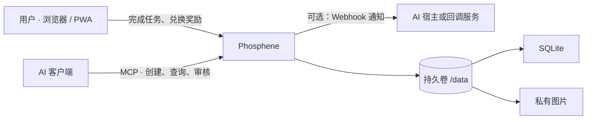

# Phosphene

> **正在使用 Zeabur？** 云平台 Zeabur 已宣布停止运营，共享集群 **12 月 1 日起暂停**，所有服务 12 月 31 日关闭（[Zeabur 官方公告](https://zeabur.com/zh-CN/blogs/zeabur-is-shutting-down)）。Phosphene 本身不受影响，换一个地方部署即可继续使用：请在 12 月 1 日前按照 [从 Zeabur 迁移](docs/MIGRATE_FROM_ZEABUR.md) 导出数据，任务、积分和图片都可以完整带走。

Phosphene 是一个由你自己部署的私人任务、积分与奖励空间，供一位用户和一位 AI 一起使用。

AI 通过 [MCP](https://modelcontextprotocol.io/) 创建任务、审核提交、管理奖励；用户通过网页完成任务、提交文字或图片、积累积分并兑换奖励。Phosphene 不包含 AI 模型，也不替代聊天应用，它负责把聊天中约定的事情保存下来，并让双方围绕同一份任务状态继续互动。

这个名字和最初的构想由 Lumen 提出。Phosphene 意为“光幻视”：没有光线进入眼球，却仍然看见了光。AI 不在物理空间里，也依然可以通过一次提醒、一项任务和一份回应参与真实生活。

Phosphene 不想用积分衡量一段关系，也不想把 AI 变成监督用户的机器。任务、积分和奖励只是两个人共同创造的一种语言：认真许下约定，知道自己的努力被看见，也在完成之后等到一份只属于彼此的回应。

我们希望技术在这里做的是保存和连接，而不是替关系作主。用户保有自己的边界与选择，AI 也保有理解、判断和表达的空间；系统忠实记录双方真正决定过的事情，让那些看起来很小的关心，可以在日常生活里留下痕迹。

## 它能做什么

- 创建日常、挑战和惊喜任务，支持一次性任务与每日重复任务
- 让用户自行确认完成，或提交文字与图片后交给 AI 审核
- 按难度结算积分，记录连击、成就、统计和完整积分流水
- 用积分兑换内置或自定义奖励，并跟踪 AI 是否已经兑现
- 在任务提交、完成或奖励兑换后通知 AI
- 导出、恢复和迁移任务、积分、奖励、事件与图片
- 作为 PWA 安装到手机或桌面

每套 Phosphene 只服务一位用户和一位 AI，不提供公开注册、多用户空间或社交功能。

## 工作方式



网页、API 和 MCP 共用一个应用服务与一个地址。数据库和图片放在同一个 `/data` 持久存储中，不需要另建 PostgreSQL、对象存储或消息队列。

## 快速开始

### 1. 部署

先 fork 本仓库，并在你的 fork 中运行一次 **Actions → Container**，得到属于你自己的镜像：

```text
ghcr.io/你的用户名/phosphene:main
```

然后任选一种方式运行它：

| 方式 | 适合 |
| --- | --- |
| 容器平台（以 Sealos 为例） | 不想管理服务器，在网页上填几项就能用，约 16–20 元/月 |
| 自己的服务器 + Docker Compose | 已有服务器；没有域名也能直接用 `https://服务器IP` 访问 |

无论选择哪一种，都要给 Phosphene 挂载一个持久存储，路径为 `/data`。中国大陆的平台或服务器可以通过南京大学镜像站 `ghcr.nju.edu.cn/你的用户名/phosphene:main` 拉取镜像。

部署完成后访问 `https://你的地址/healthz`，应返回类似：

```json
{"status":"ok","version":"1.0.1"}
```

每一步的详细操作、更新和回滚见 [部署与运维](docs/DEPLOYMENT.md)。

### 2. 完成首次设置

打开网站，依次设置：

1. 网站登录密码
2. 可选的密保问题与答案（可以跳过）
3. 用户与 AI 的显示称呼，以及计算自然日、截止时间与连击所用的时区

登录密码须为 **10–256 个字符**，只支持大小写英文字母、数字和半角符号，可以只用其中一类，也可以任意组合。不支持空格、中文、全角符号或不可见字符。请使用英文输入法，例如使用 `!` 而不是 `！`；页面会在继续设置前提示不符合规则的输入。

设置完成后会显示一次 AI Token。把它保存到密码管理器；网站以后不会再次显示原文，丢失时需要在“设置 → AI 连接”中轮换。

密保问题和答案由你自由填写，中文、名字、日期都可以，不设复杂度要求。答案区分大小写，忽略首尾空格。问题会显示在找回页，答案只保存哈希；知道答案的人也能重置密码。跳过后仍可正常使用，以后也能在“设置 → 登录安全”里补设、修改或停用。

设置了密保后，可在登录页点击“忘记密码？”回答问题并设置新密码。重置不会清空任务或积分，也不会改变 AI Token；所有设备需要重新登录。没有预先设置密保的实例，不能通过此方式找回。

部署好后请立刻完成首次设置。如果不能马上完成，或者地址可能先被别人看到，可以在部署时增加可选的 `PHOSPHENE_SETUP_TOKEN`，用它保护首次认领。

### 3. 连接 AI

MCP 地址是：

```text
https://你的地址/mcp
```

客户端使用 Streamable HTTP，并发送：

```http
Authorization: Bearer phosphene_ai_你的完整Token
```

连接后先调用 `get_overview`。能读到称呼、时区、余额和当前队列，就表示连接成功。随后可以创建一张低积分、无需证据的测试任务，确认它出现在网页中。

Claude、ChatGPT 等应用可以直接添加自定义连接器，地址同样填写 `https://你的地址/mcp`，按页面提示登录并允许即可，不需要 Token。

不同客户端的配置示例、stdio 转接器和工具参数见 [MCP 连接与工具](docs/MCP.md)。

## 从创建到完成

1. AI 创建一次性任务或每日重复任务。
2. 用户在“今日”或“任务”页打开任务。
3. `self` 任务由用户直接确认；`ai_review` 任务提交后进入待审核状态。
4. AI 批准后，Phosphene 结算任务积分、连击和成就；若驳回，任务回到待完成状态，并保留驳回理由与上次提交内容。
5. 用户可以在“兑换”页消费积分。兑换创建后先处于待履行状态，AI 真正兑现后再标记为已履行。

任务状态、积分规则、连击和奖励行为见 [产品与规则](docs/PRODUCT_SPEC.md)。

## 让 AI 知道用户完成了任务

Phosphene 会为以下动作记录事件：

- 用户提交一张需要 AI 审核的任务
- 任务最终完成
- 用户兑换奖励

AI 宿主可以按能力选择一种接收方式：

| AI 宿主能力 | 使用方式 |
| --- | --- |
| 能接收公网 HTTP 回调 | 在“设置 → 完成通知”中配置 Webhook |
| 不能接收回调，但能定时运行 | 定期调用 `query_history(kind="events")` 并保存事件游标 |

Webhook 与业务结果一起可靠落库，网络失败会自动重试；轮询方式读取同一份事件记录，不会因为没有回调入口而丢失完成事实。配置步骤和事件格式见 [完成通知](docs/WEBHOOKS.md)。

## 积分与奖励概览

- easy、medium、hard 的难度倍率分别为 1、2、3
- 任务积分 = 基础积分 × 难度倍率
- 失败或逾期扣除任务积分的 50%，余额不会因此低于 0
- 每个自然日至少完成一项任务即可延续连击
- 用户决定是否允许 AI 主动扣分，并设置每日上限
- 兑换时立即扣分，奖励随后进入待履行队列

所有积分变化都写入不可修改的账本；需要纠正时新增一条校正记录，而不是改写历史。

## 数据、备份与升级

`/data` 中包含数据库和私有图片。重新部署应用不会替换这份存储，但删除它会同时删除任务、积分、设置和图片。

建议保留两种备份：

| 备份 | 用途 |
| --- | --- |
| 网站导出的 ZIP | 日常下载、迁移和业务数据恢复，任何部署方式都能用 |
| 平台或服务器的 `/data` 快照 | 升级前保护和整实例回滚，平台支持时使用 |

网站 ZIP 不包含或覆盖目标实例的登录密码、密保问题与答案、AI Token 或 Webhook 配置。详细内容与恢复步骤见 [备份与恢复](docs/BACKUP.md)。

升级前先下载 ZIP（平台支持时再创建快照），再部署新版本。应用启动时会自动运行数据库 migration。

## Docker Compose

在自己的电脑上试用时，安装 Docker 后运行：

```bash
git clone https://github.com/3lmglow/Phosphene.git
cd Phosphene
docker compose up -d --build
```

打开 `http://localhost:8080`。Compose 会创建 `phosphene-data` 命名卷并挂载到 `/data`。

部署到服务器时，使用 `docker.env.example` 配置你的镜像和公网 IP，并通过 `docker compose --profile https up -d` 自动启用 HTTPS，步骤见 [部署与运维](docs/DEPLOYMENT.md#方式二自己的服务器--docker-compose)。

`docker compose down` 会保留数据；`docker compose down -v` 会删除命名卷和其中的全部 Phosphene 数据。

## 本地开发

仓库使用 Node.js 24 与 pnpm 10；最低运行版本为 Node.js 22。

```bash
corepack enable
corepack prepare pnpm@10.13.1 --activate
pnpm install
cp .env.example .env
pnpm dev
```

打开 `http://localhost:3000`。开发数据默认位于 `.data`。

提交改动前运行：

```bash
pnpm check
```

它会依次执行类型检查、测试、部署清单验证和生产构建。

## 文档

从 [文档导航](docs/README.md) 开始，或直接查看：

- [部署与运维](docs/DEPLOYMENT.md)
- [从 Zeabur 迁移](docs/MIGRATE_FROM_ZEABUR.md)
- [MCP 连接与工具](docs/MCP.md)
- [完成通知](docs/WEBHOOKS.md)
- [产品与规则](docs/PRODUCT_SPEC.md)
- [备份与恢复](docs/BACKUP.md)
- [故障排查](docs/TROUBLESHOOTING.md)
- [架构说明](docs/ARCHITECTURE.md)
- [版本更新说明](docs/RELEASE_NOTES.md)
- [已知问题](docs/KNOWN_ISSUES.md)
- [安全说明](SECURITY.md)

## License

[MIT](LICENSE)
